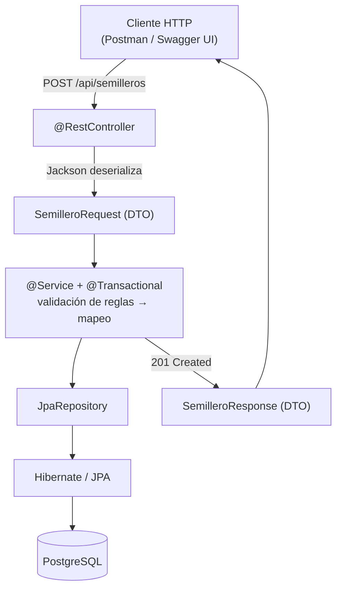
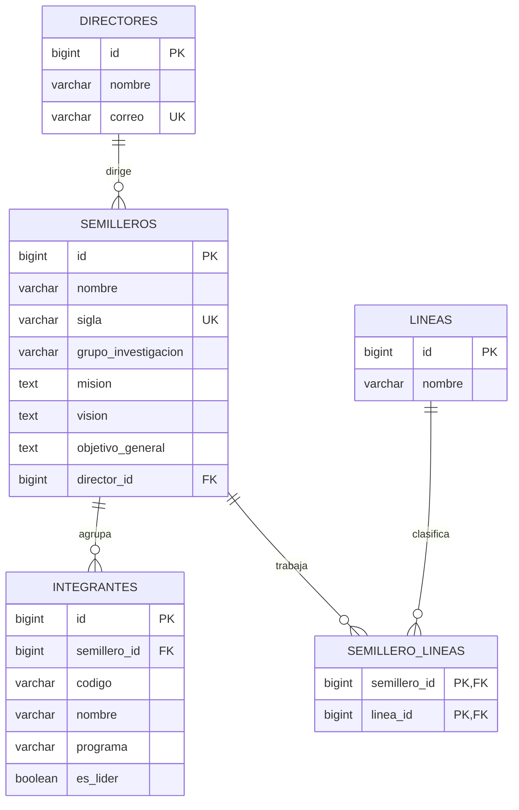

# Laboratorio: registro transaccional de semilleros de investigación


**Spring Boot · API REST · JSON anidado · Jackson · Flyway · JPA · Bean Validation · `@Transactional` · MapStruct · OpenAPI**

| Tipo de documento | Duración | Nivel |
|---|---|---|
| Guía del estudiante | 2 sesiones de 120 minutos | Intermedio |

> [!NOTE]
> Caso inspirado en el formato institucional de actualización del semillero **SIAWEB (2026-1)**. Los ejemplos emplean datos ficticios. **No se deben publicar datos personales reales** del archivo de referencia.

---

## Tabla de contenido

**Parte I. Planteamiento**
1. [Propósito y producto final](#1-propósito-y-producto-final)
2. [Contexto y alcance](#2-contexto-y-alcance)
3. [Contrato JSON de entrada](#3-contrato-json-de-entrada)
4. [Arquitectura y conceptos clave](#4-arquitectura-y-conceptos-clave)

**Parte II. Desarrollo**

5. [Sesión 1: preparación del proyecto](#5-sesión-1-preparación-del-proyecto)
6. [Modelo relacional y migración](#6-modelo-relacional-y-migración)
7. [DTO, endpoint y servicio](#7-dto-endpoint-y-servicio)
8. [Pruebas guiadas y evidencias](#8-pruebas-guiadas-y-evidencias)
9. [Sesión 2: refactorización con mappers](#9-sesión-2-refactorización-con-mappers)
10. [Ampliación: documentación con Swagger / OpenAPI](#10-ampliación-documentación-con-swagger--openapi)

**Parte III. Evaluación**

11. [Cronograma](#11-cronograma)
12. [Entregables](#12-entregables)
13. [Rúbrica](#13-rúbrica-100-puntos)
14. [Preguntas para discusión](#14-preguntas-para-discusión)
15. [Referencia del caso](#15-referencia-del-caso)

---

# Parte I. Planteamiento

## 1. Propósito y producto final

Construir desde cero una **API REST** que registre un semillero, su director, sus líneas de investigación y sus integrantes **en una sola petición**.

La operación debe ser **atómica**: si falla una validación o una inserción, no debe quedar ningún registro parcial en la base de datos.

Al finalizar, cada equipo deberá explicar el recorrido completo:

```text
HTTP → JSON → DTO → Servicio → Entidades JPA → Repositorios → Base de datos → Respuesta JSON
```

## 2. Contexto y alcance

El formato SIAWEB contiene información básica, información complementaria, datos del director y datos de los estudiantes. Para que la práctica sea viable se seleccionan estos campos:

- Nombre, sigla y grupo de investigación
- Misión, visión y objetivo general
- Líneas de investigación
- Director
- Integrantes

En el formato de referencia, el primer integrante de la lista es el líder. Para evitar ambigüedad en la API, esta práctica usa el campo booleano `esLider` y exige que haya exactamente uno.

### Reglas de negocio

| # | Regla |
|---|---|
| R1 | La sigla del semillero es única. |
| R2 | El correo del director debe ser válido. |
| R3 | Debe existir al menos una línea de investigación. |
| R4 | Debe existir al menos un integrante. |
| R5 | Los códigos estudiantiles no se repiten dentro del semillero. |
| R6 | Hay exactamente un líder. |
| R7 | Ningún error deja escrituras parciales. |

> [!IMPORTANT]
> Las relaciones y reglas son **decisiones pedagógicas**, no una copia literal del sistema institucional.

## 3. Contrato JSON de entrada

```json
{
  "nombre": "Semillero de Aplicaciones Web",
  "sigla": "SAW-01",
  "grupoInvestigacion": "Grupo de Ingeniería de Software",
  "mision": "Promover la investigación aplicada",
  "vision": "Desarrollar soluciones universitarias",
  "objetivoGeneral": "Fortalecer competencias investigativas",
  "director": {
    "nombre": "Docente Ejemplo",
    "correo": "docente@universidad.edu"
  },
  "lineas": ["Aplicaciones Web", "Sistemas Distribuidos"],
  "integrantes": [
    { "codigo": "2026001", "nombre": "Ana Ejemplo",  "programa": "Ingeniería de Sistemas", "esLider": true },
    { "codigo": "2026002", "nombre": "Luis Ejemplo", "programa": "Ingeniería de Sistemas", "esLider": false }
  ]
}
```

| Campo | Tipo JSON | Observación |
|---|---|---|
| `director` | Objeto | Se mapea a un DTO propio |
| `lineas` | Arreglo de cadenas | Lista simple de nombres |
| `integrantes` | Arreglo de objetos | Cada elemento se mapea a un DTO |

> [!TIP]
> **Para discutir:** ¿cuántas clases DTO son necesarias? ¿Qué información no debería recibir directamente una entidad JPA?

## 4. Arquitectura y conceptos clave



Cada concepto se trabaja con la misma estructura: **concepto**, **ejemplo**, **actividad** y **resultado esperado**.

### 4.1 Spring Boot y Spring Web

- **Concepto.** Spring Boot configura y arranca la aplicación. Spring Web expone endpoints HTTP mediante `@RestController`, `@PostMapping` y `@RequestBody`.
- **Ejemplo.** `@RequestBody` indica que el cuerpo JSON se convierte en un objeto Java. `ResponseEntity` permite establecer el estado HTTP y el cuerpo.
- **Actividad.** Identificar en el flujo qué componente recibe la petición y cuál debe contener la lógica de negocio.
- **Resultado esperado.** El controlador no realiza operaciones SQL ni decide reglas de integridad.

### 4.2 Jackson, DTO y Java

- **Concepto.** Jackson deserializa JSON en objetos Java. Un **DTO** representa datos del contrato externo; una **Entity** representa persistencia. Son responsabilidades distintas.
- **Ejemplo.** El objeto `director` corresponde a `DirectorRequest`; cada elemento de `integrantes` corresponde a `IntegranteRequest`.
- **Actividad.** Diseñar `SemilleroRequest`, `DirectorRequest` e `IntegranteRequest`, con getters/setters o `record`, según la versión de Java.
- **Resultado esperado.** Una petición válida se deserializa sin exponer directamente las entidades.

### 4.3 Flyway y esquema

- **Concepto.** Flyway ejecuta migraciones SQL versionadas. JPA no debe modificar el esquema por su cuenta; Hibernate solo valida la correspondencia entre entidades y tablas.
- **Ejemplo.** `V1__crear_estructura.sql` define tablas y claves; `V2__datos_iniciales.sql` puede cargar catálogos si se requieren.
- **Actividad.** Diseñar migraciones reproducibles y establecer `spring.jpa.hibernate.ddl-auto=validate`.
- **Resultado esperado.** Al arrancar sobre una BD vacía aparecen las tablas y `flyway_schema_history`; un segundo arranque no duplica estructuras.

### 4.4 JPA, Hibernate y Repository

- **Concepto.** JPA es la especificación de persistencia; Hibernate es una implementación; Spring Data JPA facilita repositorios como `JpaRepository`.
- **Ejemplo.** `@Entity`, `@Id`, `@GeneratedValue`, `@ManyToOne` y `@OneToMany` describen entidades y relaciones.
- **Actividad.** Crear entidades y repositorios, justificando dónde usar claves foráneas y restricciones `UNIQUE`.
- **Resultado esperado.** El modelo relacional representa director, semillero, líneas e integrantes con integridad referencial.

### 4.5 Bean Validation

- **Concepto.** `@Valid` activa validaciones declarativas sobre los DTO; `@NotBlank`, `@Email` y `@NotEmpty` verifican requisitos básicos. Las reglas que relacionan varios elementos requieren lógica adicional.
- **Ejemplo.** `@Valid @RequestBody SemilleroRequest request`; `@NotEmpty` sobre `integrantes`.
- **Actividad.** Rechazar correo inválido, sigla vacía y lista de integrantes vacía; definir respuestas HTTP 400.
- **Resultado esperado.** No se intenta persistir un JSON estructuralmente inválido.

### 4.6 Transacciones Spring

- **Concepto.** `@Transactional` delimita una unidad de trabajo. Por defecto, las excepciones **no comprobadas** (`RuntimeException`) provocan rollback. Las excepciones *checked* no lo provocan sin configuración adicional.
- **Ejemplo.** Un error al validar el segundo integrante debe impedir que queden guardados el director, el semillero o el primer integrante.
- **Actividad.** Implementar la operación en un método público de una clase `@Service` y comprobar el rollback con consultas SQL.
- **Resultado esperado.** Tras un fallo, los conteos de las tablas son iguales a los anteriores a la petición.

### 4.7 MapStruct

- **Concepto.** MapStruct genera en compilación el código de conversión entre DTO y Entity. No reemplaza a Jackson ni a las reglas de negocio.
- **Ejemplo.** Un mapper puede convertir `DirectorRequest` en `Director`; la asociación al semillero y la unicidad del líder siguen en el servicio.
- **Actividad.** Implementar primero la conversión manual; luego introducir MapStruct y comparar clases y responsabilidades.
- **Resultado esperado.** La API produce la misma respuesta antes y después de la refactorización.

---

# Parte II. Desarrollo

## 5. Sesión 1: preparación del proyecto

### 5.1 Creación del proyecto

Crear un proyecto **Maven** desde [Spring Initializr](https://start.spring.io) con **Java 21** y estas dependencias:

- [ ] Spring Web
- [ ] Spring Data JPA
- [ ] Validation
- [ ] Flyway Migration
- [ ] PostgreSQL Driver

Usar una versión estable de Spring Boot compatible con todas las dependencias. **MapStruct se añade en la sesión 2.**

### 5.2 Estructura de paquetes

```text
src/
└── main/
    ├── java/edu/ejemplo/semilleros/
    │   ├── controller/
    │   ├── dto/
    │   │   ├── request/
    │   │   └── response/
    │   ├── entity/
    │   ├── exception/
    │   ├── mapper/
    │   ├── repository/
    │   └── service/
    └── resources/
        ├── application.properties
        └── db/migration/
            └── V1__crear_estructura.sql
```

### 5.3 Configuración

```properties
spring.datasource.url=jdbc:postgresql://localhost:5432/semilleros_db
spring.datasource.username=${DB_USER}
spring.datasource.password=${DB_PASSWORD}
spring.jpa.hibernate.ddl-auto=validate
spring.flyway.enabled=true
spring.jpa.open-in-view=false
```

> [!WARNING]
> Reemplazar las credenciales con variables de entorno locales. **Nunca subir secretos al repositorio.** Se recomienda añadir al `.gitignore` cualquier archivo `.env` o de configuración local.

## 6. Modelo relacional y migración

### 6.1 Modelo sugerido



| Tabla | Restricciones clave |
|---|---|
| `directores` | `correo` UNIQUE |
| `semilleros` | `sigla` UNIQUE, `director_id` FK |
| `lineas` | — |
| `semillero_lineas` | PK compuesta (`semillero_id`, `linea_id`), ambas FK |
| `integrantes` | `semillero_id` FK, UNIQUE (`semillero_id`, `codigo`) |

**Decisiones de diseño:**

- En esta práctica, el director se crea junto con el semillero. En una versión institucional se definiría la reutilización de docentes.
- La regla «un solo líder» se valida en el servicio y puede reforzarse con un **índice parcial** de PostgreSQL que impida más de uno.

### 6.2 Migración inicial (fragmento)

`src/main/resources/db/migration/V1__crear_estructura.sql`

```sql
CREATE TABLE directores (
    id     BIGSERIAL    PRIMARY KEY,
    nombre VARCHAR(160) NOT NULL,
    correo VARCHAR(180) NOT NULL UNIQUE
);

CREATE TABLE semilleros (
    id                  BIGSERIAL    PRIMARY KEY,
    nombre              VARCHAR(180) NOT NULL,
    sigla               VARCHAR(30)  NOT NULL UNIQUE,
    grupo_investigacion VARCHAR(180) NOT NULL,
    mision              TEXT,
    vision              TEXT,
    objetivo_general    TEXT,
    director_id         BIGINT       NOT NULL REFERENCES directores(id)
);
```

> [!TIP]
> **Reto:** completar las tablas `lineas`, `semillero_lineas` e `integrantes`, y verificar claves primarias, foráneas y restricciones.

> [!CAUTION]
> No modificar una migración ya aplicada. Si hay que corregir algo, crear una **nueva versión** (`V2__...`, `V3__...`).

## 7. DTO, endpoint y servicio

### 7.1 DTO de entrada

```java
public record DirectorRequest(
        @NotBlank String nombre,
        @NotBlank @Email String correo) {}

public record IntegranteRequest(
        @NotBlank String codigo,
        @NotBlank String nombre,
        @NotBlank String programa,
        boolean esLider) {}
```

> [!TIP]
> **Reto:**
> - Definir `SemilleroRequest` con `@Valid` en `director` y en cada integrante, y `@NotEmpty` en las colecciones.
> - Definir `SemilleroResponse` con `id`, `sigla`, `totalIntegrantes` y `estado`.

### 7.2 Controlador

```java
@RestController
@RequestMapping("/api/semilleros")
public class SemilleroController {

    private final SemilleroService service;

    public SemilleroController(SemilleroService service) {
        this.service = service;
    }

    @PostMapping
    public ResponseEntity<SemilleroResponse> crear(
            @Valid @RequestBody SemilleroRequest request) {
        return ResponseEntity.status(HttpStatus.CREATED).body(service.crear(request));
    }
}
```

### 7.3 Algoritmo del servicio

Toda la lógica debe residir en un método `@Transactional`:

1. Validar que la sigla no exista.
2. Verificar que haya exactamente un líder y que no se repitan códigos.
3. Guardar el director.
4. Guardar el semillero.
5. Resolver o crear las líneas.
6. Asociar los integrantes.
7. Retornar el DTO de respuesta.

> [!NOTE]
> Cada equipo decide el orden de persistencia y el manejo de las relaciones, y debe justificarlo.

## 8. Pruebas guiadas y evidencias

| Caso | Entrada | Resultado esperado |
|:---:|---|---|
| T1 | JSON válido | `201`; se guardan todos los registros asociados |
| T2 | Sigla duplicada | `409`; no hay nuevas filas |
| T3 | Sin integrantes | `400`; ninguna escritura |
| T4 | Dos líderes | `400`; ninguna escritura |
| T5 | Código repetido | `400`; ninguna escritura |
| T6 | Correo inválido | `400`; validación del DTO |
| T7 | Fallo después de guardar el director | Rollback; no queda director huérfano |

### Cómo provocar T7

Lanzar temporalmente una `RuntimeException` dentro del servicio, **después** de persistir el director. Retirar esa simulación al terminar.

> [!WARNING]
> Capturar la excepción sin relanzarla puede impedir el rollback esperado.

### Evidencias requeridas

- [ ] Capturas de Postman con los códigos HTTP de cada caso
- [ ] Consulta SQL antes y después de T7
- [ ] Estructura de paquetes del proyecto
- [ ] Contenido de la tabla `flyway_schema_history`

## 9. Sesión 2: refactorización con mappers

| Paso | Acción |
|:---:|---|
| A | Localizar código repetido del tipo `setNombre(...getNombre())`. |
| B | Extraer un mapper manual. |
| C | Añadir MapStruct y su procesador de anotaciones al build de Maven. |
| D | Sustituir las conversiones simples **sin** mover al mapper consultas, validaciones de negocio ni transacciones. |

```java
@Mapper(componentModel = "spring")
public interface DirectorMapper {
    Director toEntity(DirectorRequest request);
}
```

### Responsabilidad de cada herramienta

| Herramienta | Transforma |
|---|---|
| Jackson | JSON ↔ DTO |
| MapStruct | DTO ↔ Entity |
| Hibernate | Entity ↔ tablas |

**Verificar** que el código generado por MapStruct se produce al compilar (`target/generated-sources/annotations`) y que los siete escenarios de prueba siguen pasando.

## 10. Ampliación: documentación con Swagger / OpenAPI

> [!NOTE]
> **Nota para el docente:** este módulo es una ampliación de la práctica. Puede desarrollarse al final de la segunda sesión o como actividad complementaria. Swagger UI no sustituye las pruebas automatizadas ni garantiza que la transacción sea correcta.

**Objetivo:** documentar y probar los endpoints desde el navegador, sin depender solo de Postman.

| Término | Qué es |
|---|---|
| OpenAPI | Especificación que describe el contrato de la API |
| Swagger UI | Interfaz interactiva para explorar y probar la API |
| springdoc-openapi | Biblioteca que genera la descripción OpenAPI a partir de Spring Boot |

### 10.1 Dependencia springdoc-openapi

- **Concepto.** Springdoc inspecciona los controladores de Spring MVC y expone un documento OpenAPI. No confundir la biblioteca springdoc con Swagger UI.

| Spring Boot | springdoc-openapi |
|---|---|
| 3.x | 2.x |
| 4.x | 3.x |

Verificar la matriz de compatibilidad oficial antes de fijar la versión.

```xml
<dependency>
    <groupId>org.springdoc</groupId>
    <artifactId>springdoc-openapi-starter-webmvc-ui</artifactId>
    <version>VERSION_COMPATIBLE_CON_SPRING_BOOT</version>
</dependency>
```

- **Actividad.** Añadir la dependencia al `pom.xml` con una versión compatible y ejecutar `mvn clean spring-boot:run`.
- **Resultado esperado.**
  - http://localhost:8080/swagger-ui/index.html muestra la interfaz.
  - http://localhost:8080/v3/api-docs devuelve JSON.

### 10.2 Anotaciones para describir el endpoint

- **Concepto.** `@Tag` agrupa operaciones; `@Operation` describe una acción; `@ApiResponse` documenta respuestas HTTP; `@Schema` aporta descripciones y ejemplos de campos. Estas anotaciones enriquecen la documentación, pero **no sustituyen** las validaciones ni la implementación.

```java
@Tag(name = "Semilleros", description = "Registro de semilleros")
@RestController
@RequestMapping("/api/semilleros")
public class SemilleroController {

    private final SemilleroService service;

    public SemilleroController(SemilleroService service) {
        this.service = service;
    }

    @Operation(summary = "Registrar semillero",
               description = "Crea un semillero con sus integrantes")
    @ApiResponses({
        @ApiResponse(responseCode = "201", description = "Creado"),
        @ApiResponse(responseCode = "400", description = "Datos inválidos"),
        @ApiResponse(responseCode = "409", description = "Conflicto")
    })
    @PostMapping
    public ResponseEntity<SemilleroResponse> crear(
            @Valid @RequestBody SemilleroRequest request) {
        return ResponseEntity.status(HttpStatus.CREATED).body(service.crear(request));
    }
}
```

- **Actividad.** Adaptar el ejemplo a los nombres reales del proyecto y agregar `@Schema` en al menos tres propiedades del DTO.
- **Resultado esperado.** Swagger UI muestra la operación `POST`, el esquema del JSON de entrada y los códigos de respuesta previstos.

### 10.3 Probar un JSON anidado desde Swagger UI

- **Concepto.** La opción **Try it out** envía solicitudes reales a la API. Swagger UI **no simula** la base de datos: al pulsar **Execute** se invoca el endpoint y se ejecuta la transacción.

Ejemplo reducido, solo ilustrativo:

```http
POST /api/semilleros
Content-Type: application/json

{
  "nombre": "Semillero SIAWEB",
  "integrantes": [
    { "codigo": "10001", "nombre": "Ana",  "esLider": true },
    { "codigo": "10002", "nombre": "Luis", "esLider": false }
  ]
}
```

- **Actividad.** Usar el [JSON contractual completo](#3-contrato-json-de-entrada). Ejecutar una solicitud válida y otra con un integrante inválido, y observar los códigos y las respuestas.
- **Resultado esperado.** La petición válida retorna `201` con el DTO de respuesta; la inválida retorna el código de error implementado y no deja registros parciales.

### 10.4 Swagger y validaciones

- **Concepto.** Las restricciones de Jakarta Bean Validation (`@NotBlank`, `@NotNull`, `@NotEmpty`, `@Size`, `@Valid`) pueden reflejarse en el esquema de entrada. `@Valid` debe aplicarse a los objetos anidados cuando se requiere validación en cascada.

```java
public record SemilleroRequest(

        @NotBlank
        @Schema(description = "Nombre del semillero", example = "Semillero de Aplicaciones Web")
        String nombre,

        // ... demás campos

        @NotEmpty
        @Valid
        List<IntegranteRequest> integrantes) {}
```

- **Actividad.** Revisar las validaciones del modelo real y documentar campos obligatorios, ejemplos y restricciones. Comparar la documentación con el comportamiento efectivo de la API.
- **Resultado esperado.** El esquema OpenAPI representa correctamente los campos requeridos, y los errores de validación se manejan de forma coherente.

### 10.5 Evidencias y reflexión

- [ ] Captura de Swagger UI con el endpoint `POST /api/semilleros`
- [ ] Captura de una ejecución exitosa con respuesta `201`
- [ ] Captura de una solicitud inválida y explicación del rollback comprobado en la base de datos
- [ ] JSON generado en `/v3/api-docs` (archivo o captura)

**Preguntas:**

1. ¿En qué se diferencian OpenAPI, Swagger UI, Jackson y MapStruct?
2. ¿Por qué documentar un código `409` no hace que Spring lo devuelva automáticamente?

---

# Parte III. Evaluación

## 11. Cronograma

### Sesión 1

| Tiempo | Actividad |
|:---:|---|
| 15 min | Contexto y JSON |
| 20 min | Creación del proyecto |
| 25 min | Flyway |
| 25 min | Entidades |
| 25 min | DTO y controlador |
| 10 min | Verificación |

### Sesión 2

| Tiempo | Actividad |
|:---:|---|
| 35 min | Servicio transaccional |
| 25 min | Pruebas |
| 25 min | Mapper manual |
| 25 min | MapStruct |
| 10 min | Cierre |

## 12. Entregables

- [ ] Repositorio Maven
- [ ] Migraciones SQL
- [ ] Colección de peticiones (Postman) o instrucciones `curl`
- [ ] `README.md` con instrucciones de ejecución
- [ ] Evidencias de rollback
- [ ] Comparación breve entre conversión manual y MapStruct

## 13. Rúbrica (100 puntos)

| Criterio | Puntos |
|---|:---:|
| Proyecto y configuración reproducible | 10 |
| Migraciones Flyway e integridad relacional | 15 |
| Entidades y repositorios JPA | 15 |
| DTO, JSON y validación | 15 |
| Servicio y reglas de negocio | 20 |
| Atomicidad y prueba de rollback | 15 |
| MapStruct y comparación argumentada | 5 |
| Evidencias y README | 5 |
| **Total** | **100** |

## 14. Preguntas para discusión

1. ¿Por qué no es recomendable recibir directamente una Entity en `@RequestBody`?
2. ¿Qué diferencia hay entre deserializar JSON y mapear un DTO a una Entity?
3. ¿Qué responsabilidad corresponde a Flyway y cuál a Hibernate?
4. ¿Qué sucede si la última inserción falla después de guardar tres entidades?
5. ¿Cómo evitar que dos solicitudes simultáneas registren la misma sigla?
6. ¿Qué regla debe validarse en el servicio y cuál conviene reforzar en la base de datos?

## 15. Referencia del caso

Archivo institucional **«FORMATO ACTUALIZACION SEMILLERO 2026-1_SIAWEB»**. Los ejemplos y el modelo se adaptaron con fines académicos.
